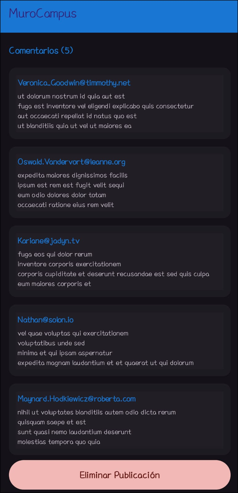
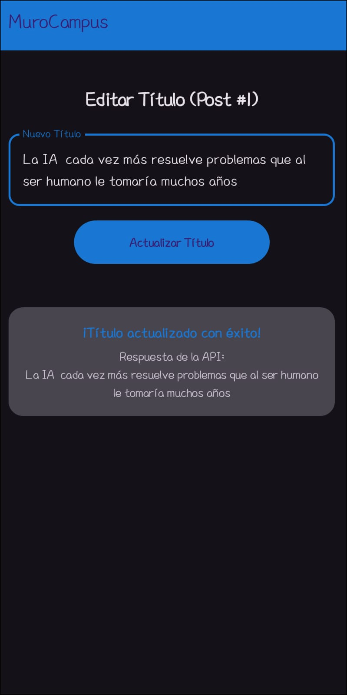
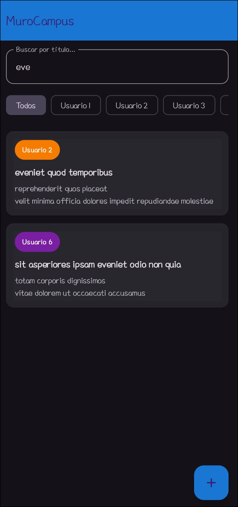

# Registro de Prompts y Criterio Técnico (PROMPTS.md)

Este documento registra los prompts de mejora utilizados durante el desarrollo de la aplicación y el análisis técnico correspondiente.

| Prompt que escribí | Qué respondió Gemini | Qué cambié o descarté | Por qué |
| :--- | :--- | :--- | :--- |
| Implementa un botón **Eliminar** en el detalle de publicación de MuroCampus usando `@DELETE("posts/{id}")` y `Response<Unit>`. Validar respuesta HTTP y actualizar lista. Modifica API, Repository, ViewModel y View. | Se añadió `@DELETE` con `Response<Unit>` en Retrofit, validación `isSuccessful` en el Repositorio envuelto en `Result`, acción de borrado en el ViewModel con recarga de lista, y botón Eliminar en la pantalla de detalle. | Se mantuvo la arquitectura en capas (MVVM + Repository) evitando acoplar Retrofit directamente a la UI, manejando la respuesta HTTP como un `Result<Unit>`. | Mantiene la consistencia con el manejo de errores centralizado y el principio de responsabilidad única de la arquitectura. |
| Prompt 2: Implementa una pantalla para editar el título de una publicación en MuroCampus utilizando `@PUT` o `@PATCH` y muestra la respuesta de la API. Realiza los cambios en API, Repository, ViewModel y View. | Se añadió el método `@PATCH` en `PostApi`, la implementación en `PostRepositoryRemote`, el estado reactivo `editarEstado` en el `PostsViewModel`, y la nueva pantalla `PantallaEditar.kt` con su respectiva navegación en `MainActivity`. | Se optó por utilizar `@PATCH` en lugar de `@PUT` para enviar únicamente el campo `title` modificado mediante un mapa, optimizando el payload de red. | El uso de `@PATCH` es semánticamente más correcto para actualizaciones parciales y reduce el tráfico de red. |
| prompt 3: Implementa un campo de búsqueda en MuroCampus que filtre por título las publicaciones ya descargadas, sin realizar nuevas peticiones a la API. Modifica únicamente ViewModel y View, respetando la arquitectura MVVM + Repository. | Se añadió un respaldo de la lista original (`postsOriginales`) y el StateFlow `busquedaQuery` en el ViewModel junto con el método `buscar()`. En la vista (`PantallaLista`), se incorporó un `OutlinedTextField` de búsqueda que filtra localmente en tiempo real. | Se descartó realizar llamadas adicionales a la API para la búsqueda, optando por filtrado en memoria (`filter { it.title.contains(query, ignoreCase = true) }`) sobre la lista ya cacheada en el ViewModel. | Cumple con la restricción de evitar peticiones innecesarias de red y mejora drásticamente el rendimiento y la experiencia de usuario con búsqueda instantánea local. |

---

## 🖼️ Evidencias de Mejoras (Prompts 1, 2 y 3)

<table>
  <tr>
    <td align="center"><b>1. Botón Eliminar (@DELETE)</b>    Eliminación de publicaciones validando respuesta HTTP.</td>
    <td align="center"><b>2. Editar Título (@PATCH)</b>    Pantalla de edición y actualización parcial del título.</td>
    <td align="center"><b>3. Búsqueda Local por Título</b>    Filtrado reactivo en memoria sin llamadas a la API.</td>
  </tr>
</table>
