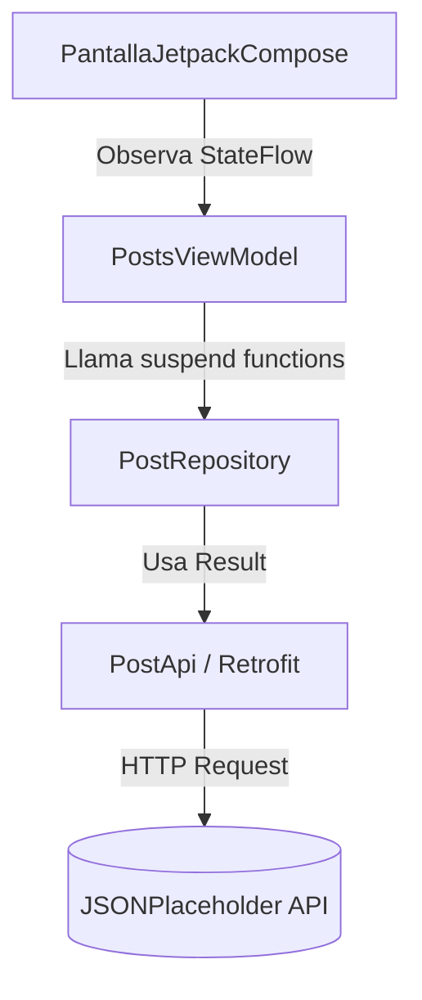
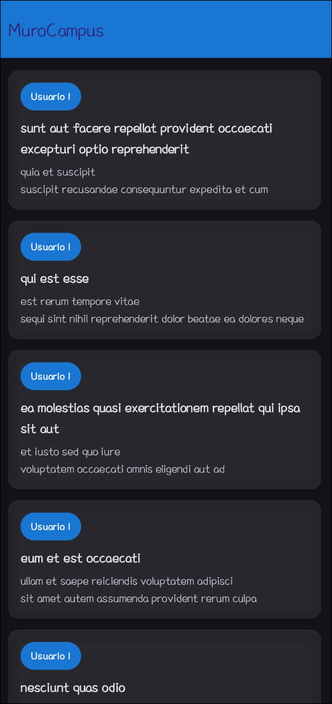
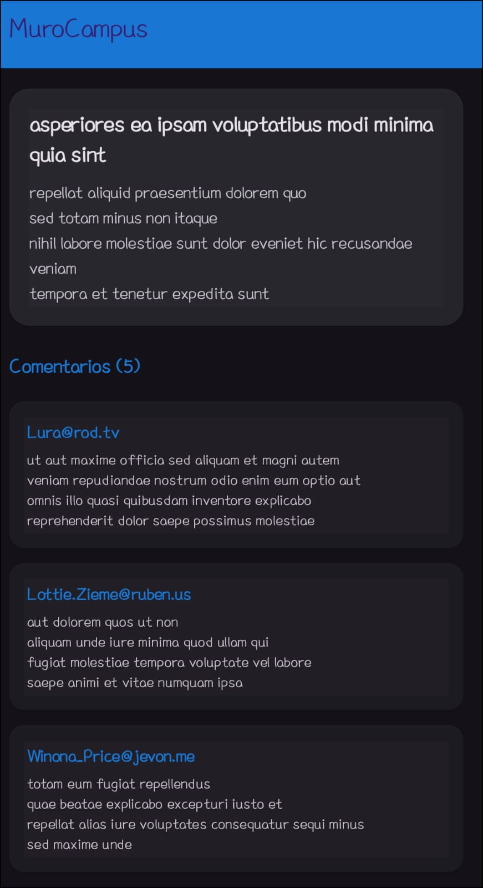
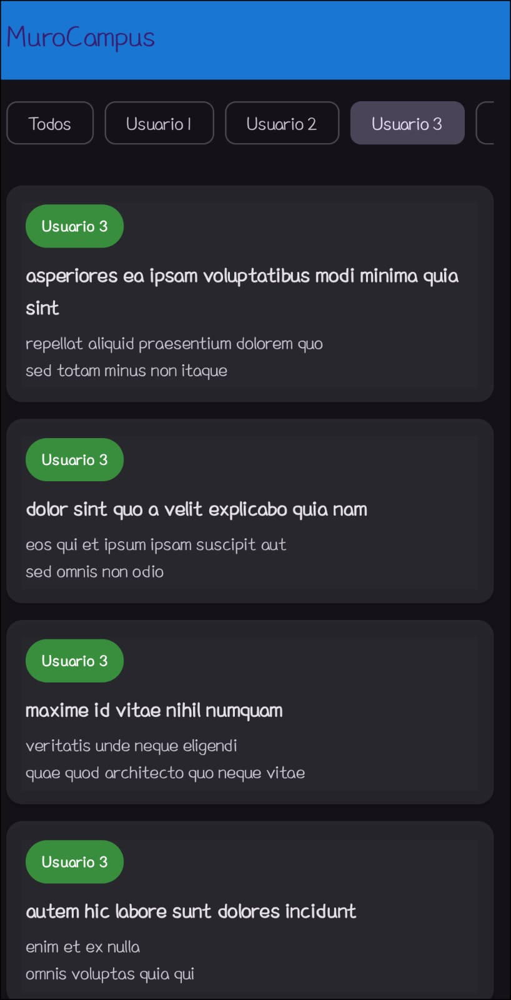
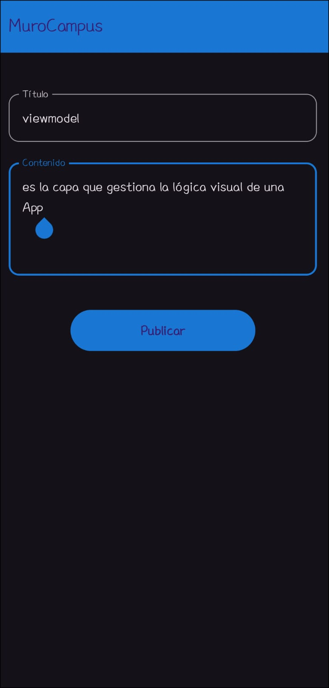
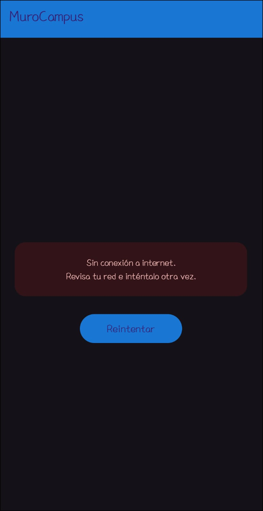

# MuroCampus

Aplicación Android desarrollada en **Jetpack Compose** que consume la API pública de [JSONPlaceholder](https://jsonplaceholder.typicode.com/) utilizando **Retrofit**, **Kotlin Coroutines**, **Kotlinx Serialization**, y siguiendo estrictamente la arquitectura **MVVM** junto con el patrón **Repository**.

---

## 🏗️ Arquitectura MVVM y Estructura de Paquetes

La aplicación está organizada bajo los principios de separación de responsabilidades y Clean Architecture:

```text
com.carbajal.murocampus/
├── data/
│   ├── PostRepository.kt         # Contrato e implementación del Repositorio
│   └── remote/
│       ├── PostApi.kt            # Interfaz de Retrofit con anotaciones HTTP (@GET, @POST, @Path, @Query, @Body)
│       └── RetrofitClient.kt     # Instancia Singleton de Retrofit y OkHttpClient con interceptor de logs
├── model/
│   └── Modelos.kt                # Data classes serializables (@Serializable) para Post, Comentario y NuevoPost
├── ui/
│   ├── Componentes.kt            # Componentes reutilizables (Tarjetas de publicaciones)
│   ├── PantallaLista.kt          # Pantalla principal con lista, filtros por usuario (Chips) y estado de carga/error
│   ├── PantallaDetalle.kt        # Pantalla de detalle con la publicación y sus comentarios con @Path
│   └── PantallaCrear.kt          # Pantalla de formulario para crear publicaciones con @POST y validaciones
├── viewmodel/
│   ├── PostsViewModel.kt         # ViewModel gestionando estados reactivos (UiState) y corrutinas
│   └── PostsViewModelFactory.kt  # Factoría para inyección de dependencias del Repositorio
└── MainActivity.kt               # Actividad principal y enrutador de pantallas (Lista, Detalle, Crear)
```

### Diagrama Arquitectural (MVVM)



---

## 🖼️ Capturas de Pantalla

<table>
  <tr>
    <td align="center"><b>1. Lista de Publicaciones</b><br><br><br><br><sub>Muestra la colección de posts con badges de usuario.</sub></td>
    <td align="center"><b>2. Detalle y Comentarios</b><br><br><br><br><sub>Publicación y comentarios asociados con @Path.</sub></td>
    <td align="center"><b>3. Filtrado por Usuario</b><br><br><br><br><sub>Filtro de posts por chips usando @Query.</sub></td>
  </tr>
  <tr>
    <td align="center"><b>4. Crear Publicación</b><br><br><br><br><sub>Formulario POST y respuesta de éxito.</sub></td>
    <td align="center"><b>5. Error y Reintento</b><br><br><br><br><sub>Manejo offline con botón Reintentar.</sub></td>
    <td align="center"></td>
  </tr>
</table>

---

## 🧠 Para Pensar (Preguntas de Reflexión)

1. **¿Qué diferencia hay entre GET y POST? ¿Por qué crear lleva `@Body` y por qué `porUsuario` lleva `@Query`?**
   * `GET` solicita y recupera recursos del servidor de forma idempotente y sin alterar el estado. `POST` envía datos nuevos al servidor para su creación o procesamiento.
   * `crear` utiliza `@Body` porque envía un objeto serializable completo (`NuevoPost`) en el cuerpo de la petición HTTP. `porUsuario` utiliza `@Query` porque adjunta parámetros de filtrado en la URL (ej. `?userId=1`).

2. **¿Por qué la ruta es `"posts"` y no `"/posts"`?**
   * En Retrofit, las rutas relativas que no comienzan con `/` se concatenan de forma segura al final de la `base_url`. Si se usara `"/posts"`, Retrofit lo interpretaría como una ruta absoluta desde la raíz del dominio, ignorando cualquier subpath o prefijo configurado en la URL base.

3. **¿Por qué el Repository devuelve `Result` en vez de dejar que la excepción llegue al ViewModel?**
   * Para encapsular y blindar el manejo de errores de red o serialización dentro de la capa de datos. Esto evita que excepciones imprevistas rompan el flujo de ejecución, permitiendo que el ViewModel maneje el éxito (`Result.success`) o el fallo (`Result.failure`) de manera limpia y explícita.

4. **¿Qué pasa si olvidas el permiso `INTERNET`? ¿Y si olvidas `ignoreUnknownKeys` y el servidor agrega un campo nuevo?**
   * Sin el permiso `INTERNET`, la app lanzará una excepción de red al intentar comunicarse con el servidor.
   * Si se omite `ignoreUnknownKeys` y el servidor añade un campo nuevo no declarado en las data classes, el serializador lanzará una excepción de deserialización (`SerializationException`) al encontrar propiedades desconocidas.

5. **¿Por qué la pantalla de lista usa un `when` sobre `UiState` y no un `if` con tres variables?**
   * Porque `UiState` es una interfaz sellada (`sealed interface`), lo que garantiza exhaustividad en tiempo de compilación y mutua exclusividad. Un `when` es idiomático, seguro y previene estados lógicos imposibles (como estar en estado de carga y de éxito simultáneamente).

6. **JSONPlaceholder no guarda los POST. ¿Cómo cambiaría tu app si usaras un servicio real?**
   * En un backend real con base de datos, la petición `POST` exitosa devolvería el objeto recién creado con un ID real autogenerado por el servidor. La aplicación debería actualizar su estado local o insertar el nuevo post al inicio de la lista local para reflejar la persistencia inmediata.
